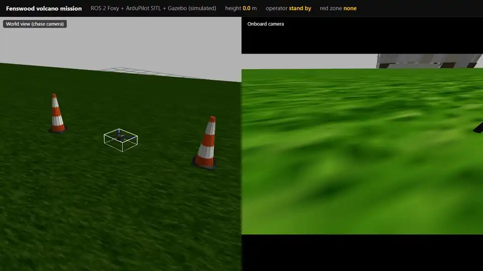

<h1 align="center">Fenswood Volcano Mission</h1>

<p align="center"><strong>A ROS&nbsp;2 drone mission that flies a survey corridor, finds the volcano's hot zones with its camera and lands clear&nbsp;of&nbsp;them.</strong></p>

<p align="center">It runs in simulation with ArduPilot SITL, MAVROS and Gazebo in Docker.<br>The mission code comes from the University of Bristol Group Project in Aerial Robotics (2022) and flies again in&nbsp;the April&nbsp;2022&nbsp;simulator&nbsp;release.</p>

<p align="center"><a href="#what-it-does">What&nbsp;it&nbsp;does</a>&nbsp;&nbsp; &nbsp;&nbsp;<a href="#install">Install</a>&nbsp;&nbsp; &nbsp;&nbsp;<a href="#usage">Usage</a>&nbsp;&nbsp; &nbsp;&nbsp;<a href="#common-questions">Common&nbsp;questions</a>&nbsp;&nbsp; &nbsp;&nbsp;<a href="#known-limits">Known&nbsp;limits</a>&nbsp;&nbsp; &nbsp;&nbsp;<a href="#license">License</a></p>

<p align="center"></p>

<p align="center">The animation runs at 4× speed. <a href="https://github.com/AdilShaikh1/fenswood-volcano-mission/releases/download/v1.0.0/fenswood-demo.mp4">Watch the full run in real time</a> (MP4, 2&nbsp;min&nbsp;40&nbsp;s).</p>

## What it does

The scenario is a volcano survey at the Fenswood field site near Bristol. The drone takes off from a set point, climbs to 20 m and flies four waypoints through a corridor that avoids a no-fly zone. Over the survey area it tilts its camera down, finds the red hot zones by colour and moves clear of them, then lands outside the red and yellow zones.

Three ROS 2 nodes run the mission:

- `controller_finite_state` is a state machine (init, arming, climbing, on_way1, on_way2, landing, RTH, exit). It sends position, velocity and mode commands to ArduPilot through MAVROS.
- `image_processor` masks the red and yellow zones in each camera frame and publishes where they sit in the image on `/red_zone_alert` and `/yellow_zone_alert`.
- `failsafe` holds the operator mode (`stand by`, `take off`, `land`, `rth`) on `/failsafe_md` and publishes a status image.

`PathPlan2.py` builds the corridor waypoints with a visibility graph. The no-fly-zone and flight-region polygons are coordinates in its code. It writes them to a `POLYGONS` shapefile inside the container and reads that file back.

## When to reach for it

Use it to watch a complete ROS 2 and ArduPilot mission in simulation, from arming to landing, or as a worked example of a colour-based landing decision on a simulated camera. It's also the reference run for a planned port to ROS 2 Jazzy and Gazebo Harmonic, so the port can be checked against a known-good flight.

## Install

**Requirements.** Docker with Linux containers on an x86_64 machine, about 12 GB of free disk for the images, and ports 8080, 9090 and 5761 free. Docker Desktop on Windows with WSL 2 works.

```bash
git clone https://github.com/AdilShaikh1/fenswood-volcano-mission
cd fenswood-volcano-mission/fenswood_volcano_template
docker compose -f docker-compose-finite-state.yml pull simhost sitl mavros rosbridge-suite
```

The first `up` also builds the controller image. The build locks the Python packages with uv to the versions available in May 2022, so the code needs no changes for newer package APIs.

## Usage

Start the stack from `fenswood_volcano_template/`:

```bash
docker compose -f docker-compose-finite-state.yml up -d --build
```

Open <http://localhost:8080> for the 3D world. The drone spawns at the take-off point. Wait until the controller reaches `arming`:

```bash
docker compose -f docker-compose-finite-state.yml logs -f controller
```

The mission waits for the operator. Send `take off` on `/failsafe_md` from a shell inside the controller container:

```bash
docker compose -f docker-compose-finite-state.yml exec controller bash
source /opt/ros/foxy/setup.bash
timeout 5 ros2 topic pub -r 1 /failsafe_md std_msgs/msg/String "{data: 'take off'}"
```

The drone climbs, flies the corridor and lands in about three minutes. During the climb, the same command with `land` or `rth` lands the drone where it is or sends it home. Stop the stack with `docker compose -f docker-compose-finite-state.yml down`.

To watch the drone, use the two tools in `tools/viewer/`:

- `drone-cam.html` shows the onboard camera live. Open the file in a browser while the stack runs.
- `chase-cam.js` keeps the Gazebo camera on the drone. Once the drone shows in the world, paste it into the browser console on <http://localhost:8080>. Paste it again to re-centre. It hides the gzweb menu, and reloading the page brings the menu back.

## Common questions

**The controller says `Failed to arm`.** It gives the operator about 400 steps in `arming`, roughly 6.7 minutes, to send `take off`. Restart the controller with `docker compose -f docker-compose-finite-state.yml restart controller` and send the command once the log shows `arming` again.

**`sitl` or `simhost` restarted once at start-up.** That's expected. Each looks the other up by name when it starts and exits if the other isn't running yet, so the compose file restarts them until both are up.

**Why is the simulator image pinned to an old version?** The current `latest` `starling-sim-iris-ap-fenswood` image (December 2022) fails ArduPilot's pre-arm check with `Gyros not calibrated`. Version v0.0.2 (April 2022) predates the sensor payload added later and passes. The images in between weren't tested.

**`ros2 topic echo` inside a container shows nothing.** `ros2 topic echo` and `ros2 topic hz` don't work reliably through `docker exec` in these containers. `ros2 topic pub`, used for the take-off, works. Use `tools/viewer/topic_rates.py` (below) or rosbridge on port 9090 instead.

**Does it run on ROS 2 Jazzy or Gazebo Harmonic?** Not yet. The stack is ROS 2 Foxy, Ubuntu 20.04, Python 3.8 and Gazebo Classic, which have all reached end of life. A port to Jazzy, Gazebo Harmonic and current Python packages is planned.

## It's working if

- The controller log shows `Arming successful`, `on_way1`, four `Close enough to target` lines, `on_way2`, `Camera tilt command 1.57 rad`, `Landing point reached` and `Request sent for land mode`.
- The drone ends up on the ground outside the red and yellow zones. In the reference runs it landed and disarmed at about 51.42213, -2.66816.
- `topic_rates.py` reports about 20 Hz on `/red_zone_alert` and about 1 Hz on `/status_frames` throughout. On the corridor and over the survey area it reports about 0.2 Hz on `/failsafe_md`. The controller node stops about 10 to 12 minutes after it starts, which is after the landing in a normal run. Before the corridor and after the controller stops, `/failsafe_md` runs at about 0.1 Hz, which comes from the failsafe node alone.

## Tests

There are no automated tests. The check is a full simulated mission plus a rate measurement. Run the mission as in Usage, and measure the topic rates from inside the controller container while the drone flies the corridor:

```bash
docker compose -f docker-compose-finite-state.yml cp ../tools/viewer/topic_rates.py controller:/tmp/topic_rates.py
docker compose -f docker-compose-finite-state.yml exec controller bash -c "source /opt/ros/foxy/setup.bash && python3 /tmp/topic_rates.py 30"
```

Run both commands from `fenswood_volcano_template/`. The `30` is the measuring window in seconds.

## Known limits

These come from the 2022 mission design and are left for the Jazzy port:

- The mission ends at the landing. It doesn't take off again or fly the corridor home.
- `rth` hands over to ArduPilot's return-to-launch, which flies a straight line home and may cross the no-fly zone.
- Once the drone leaves the climb, the controller doesn't read `land` or `rth` until it reaches its landing point. An `rth` sent earlier then turns the landing into a return-to-launch. This comes from reading the code and hasn't been flown.
- If the drone is already more than 35 m from the survey area when a red zone first sits in the outer quarter of the camera image, it lands at once. It still lands outside the zones but close to the yellow edge.
- An operator command other than `stand by`, `take off`, `land` or `rth` sent right after the climb, such as `hover`, stops the mission.
- The image processor reads the camera's RGB frames as BGR. The red and yellow ranges in the code are set for that order.

## Repository layout

```text
fenswood_volcano_template/
  docker-compose-finite-state.yml   the mission stack (simulator, SITL, MAVROS, rosbridge, controller)
  fenswood_drone_controller/        the ROS 2 package: the three mission nodes, PathPlan2.py, launch files, Dockerfile
  POLYGONS.*                        a copy of the polygons the planner writes (same geometry; the mission doesn't read it)
  tutorial/, README.md, other compose files   the original course template, unchanged
tools/viewer/                       drone-cam.html, chase-cam.js and topic_rates.py for watching and checking a run
CHANGELOG.md                        release notes
docs/HANDOVER.md                    notes for the next maintainer: how the stack connects, what changed since 2022, pins, gotchas
docs/media/                         the demo animation (animated WebP, 4× speed)
```

## Credits

The mission code and planning (the state machine, failsafe, image processing, path planner, flight-zone shapefile, Dockerfiles and launch files) are by Adil Shaikh. The project was team 2's entry for AENGM0074 Group Project in Aerial Robotics at the University of Bristol in 2022. The team was Bundoi Mihai Radu, Prithvi Decca, Xupeng Li, Yuto Noda, Adil Shaikh and Xiran Wang.

The `fenswood_volcano_template` base and its tutorial come from Arthur Richards' [Fenswood Volcano template](https://github.com/arthurrichards77/fenswood_volcano_template). The simulator, SITL, MAVROS and rosbridge images are the University of Bristol Flight Lab's [Starling](https://github.com/StarlingUAS/ProjectStarling) images.

## License

The mission code is MIT licensed. See [LICENSE](LICENSE). The `fenswood_volcano_template` base is course material without a licence of its own and isn't covered by the MIT licence. See [NOTICE](NOTICE).
